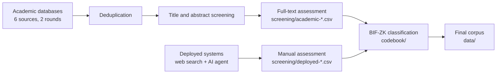

# Search-Query-SoK

**Search log, screening records and classification data for the systematic review behind our SoK on zero-knowledge (ZK) blockchain interoperability protocols**

## About

This repository documents how the literature for the SoK was found, filtered and classified. It records:

- every database query and the number of records each search returned;
- the decisions made while screening candidate papers and deployed systems, with the reason for each exclusion;
- the BIF-ZK classification of every included solution, with the reasoning behind its inclusion;
- the rules used to make those decisions.

The aim is transparency and reproducibility. Anyone should be able to re-run the searches, see why a paper or system was kept or dropped, and check each classification against the stated rules.

The review covers two kinds of sources:

- **Academic literature**, collected from six bibliographic databases in two search rounds.
- **Deployed systems**, i.e. ZK-based interoperability protocols with a practical implementation, collected through predefined web searches and an AI search agent.

## Repository structure

```text
Search-Query-SoK/
├── README.md
├── search/
│   └── search_query.md            ← queries, search links and record counts
├── screening/
│   ├── academic-candidates.csv    ← every academic record assessed in full text, with its decision
│   ├── academic-exclusions.csv    ← the excluded academic records, with reasons
│   ├── deployed-candidates.csv    ← every deployed-system candidate, with its decision
│   └── deployed-exclusions.csv    ← the excluded deployed candidates, with reasons
├── data/
│   ├── bif-zk-academic.csv        ← BIF-ZK classification of the 64 academic proposals (Table 3)
│   └── bif-zk-deployed.csv        ← BIF-ZK classification of the 27 deployed systems (Table 6)
└── codebook/
    └── classification-rules.md    ← eligibility and classification rules
```

### `search/`: how the records were found

[`search/search_query.md`](search/search_query.md) is the full search log. It contains:

- the Boolean query used in all databases and how it is built (interoperability terms *and* ZK terms, *or* phrases that combine both);
- links that reopen each search with the original query and filters for **ScienceDirect, Scopus, IEEE Xplore, ACM Digital Library, Web of Science and Google Scholar**;
- record counts per database and round, including the five query partitions ScienceDirect needed;
- the Google Scholar sampling strategy (the first 400 results in each of five publication-year intervals);
- the deployed-system search: the 15 predefined web queries and the prompts given to the AI agent.

### `screening/`: what was kept and what was dropped

Each `*-candidates.csv` file lists every record that reached the final assessment stage, together with its decision. The matching `*-exclusions.csv` file repeats the excluded records with the reason. The `id` column links the two.

| File | Rows | Contents |
|---|---:|---|
| [`academic-candidates.csv`](screening/academic-candidates.csv) | 342 | 239 round-1 and 103 round-2 records, with bibliographic data and the decision on each |
| [`academic-exclusions.csv`](screening/academic-exclusions.csv) | 237 | the academic records not included, with the reason |
| [`deployed-candidates.csv`](screening/deployed-candidates.csv) | 70 | every deployed-system candidate, how it was found and the decision on it |
| [`deployed-exclusions.csv`](screening/deployed-exclusions.csv) | 43 | the deployed candidates not included, with the reason |


### `data/`: the final corpus

Both files start with the same columns: `entry` (the table row, matching `table_entry` in `screening/`), `references` (citation numbers in the SoK), and `title` and `link` of the primary source. They then share the classification columns, in the same order. The academic file adds `authors`, `year`, `venue` and `round`. The deployed file adds `website`, `deployment_status` and `subgroup`.

| File | Rows | Corresponds to |
|---|---:|---|
| [`bif-zk-academic.csv`](data/bif-zk-academic.csv) | 64 | Table 3: non-deployed academic proposals |
| [`bif-zk-deployed.csv`](data/bif-zk-deployed.csv) | 27 | Table 6: deployed systems, with deployment status and website |

Scores use `full`, `partial` and `none` for the filled, half-filled and empty circles in the SoK's tables, and `N/A` where a value could not be determined.

### `codebook/`: how solutions were classified

[`codebook/classification-rules.md`](codebook/classification-rules.md) sets out the decision sequence:

1. eligibility tests and exclusion codes;
2. corpus assignment (deployed or non-deployed);
3. a step-by-step procedure, with tie-breakers, for the 7 BIF mechanism categories;
4. the trust-model annotation;
5. the 7 functional roles;
6. the proof objectives;
7. the proof-system profiles;
8. the open-source and security-assurance labels.

## Methodology in brief




## Reproducing the searches

The links in the search log open each database with the exact query and filters that were used. Note that:

- **Scopus, Web of Science and ScienceDirect** require institutional access.
- Database contents change over time, so re-running a search today will likely return more records than reported here.
- **Google Scholar** must be repeated once per publication-year interval (2020–2021, 2022–2023, 2024, 2025, 2026), screening the first 400 results of each.
