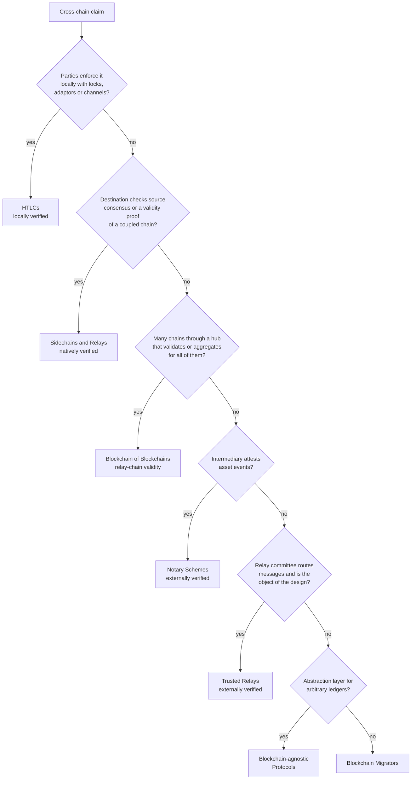

# BIF-ZK classification rules

This codebook states the rules used to decide whether a solution belongs in the SoK and, if it does, how it is coded in BIF-ZK. It applies to both protocol corpora: the non-deployed academic proposals (Table 3 of the SoK, [`data/bif-zk-academic.csv`](../data/bif-zk-academic.csv)) and the deployed systems (Table 6, [`data/bif-zk-deployed.csv`](../data/bif-zk-deployed.csv)).

The definitions follow Sections 4 and 5 of the SoK. Where the SoK gives no explicit rule, the rule below is derived from how the corpus was actually coded, and the entries it is based on are named as precedents.

## Contents

1. [Order of decisions](#1-order-of-decisions)
2. [Eligibility](#2-eligibility)
3. [Corpus assignment: deployed or non-deployed](#3-corpus-assignment-deployed-or-non-deployed)
4. [BIF mechanism category](#4-bif-mechanism-category)
5. [Trust-model annotation](#5-trust-model-annotation)
6. [Functional roles](#6-functional-roles)
7. [Proof objectives](#7-proof-objectives)
8. [Proof-system profile](#8-proof-system-profile)
9. [Open source](#9-open-source)
10. [Security assurance](#10-security-assurance)
11. [Coding procedure](#11-coding-procedure)
12. [Worked examples](#12-worked-examples)

---

## 1. Order of decisions

Code every solution in this order. Each step uses the result of the previous one.

| Step | Question | Result |
|---:|---|---|
| 1 | Does the solution meet the inclusion criterion? | include, or an exclusion code ([§2](#2-eligibility)) |
| 2 | Is it a deployed system or a non-deployed proposal? | deployed or academic corpus ([§3](#3-corpus-assignment-deployed-or-non-deployed)) |
| 3 | Which interoperability mechanism carries the cross-chain claim? | one of the 7 BIF categories ([§4](#4-bif-mechanism-category)) |
| 4 | Who verifies the claim? | trust-model annotation, with a dagger for optimistic verification ([§5](#5-trust-model-annotation)) |
| 5 | What does each ZKP prove? | one or more functional roles ([§6](#6-functional-roles)) |
| 6 | What does the ZKP achieve? | confidentiality, succinctness and anonymity scores ([§7](#7-proof-objectives)) |
| 7 | Which proof system produces the proof? | proof-system profile ([§8](#8-proof-system-profile)) |
| 8 | Engineering maturity | open source ([§9](#9-open-source)) and security assurance ([§10](#10-security-assurance)) |

Score values are written `full`, `partial`, `none` or `N/A` in the CSV files. They correspond to the filled, half-filled and empty circles in the SoK's tables.

---

## 2. Eligibility

### Inclusion criterion

> Protocol papers are retained only when the use of ZKPs forms a concrete part of the proposed interoperability mechanism, either by verifying cross-chain claims or by providing properties such as confidentiality or anonymity integral to cross-chain operations. The same criterion applies to deployed systems. (SoK, Section 4)

Survey papers are retained when their scope contributes to the analysis of general blockchain interoperability or of zero-knowledge-based interoperability.

### Tests

Apply the tests in order. The first test that fails gives the exclusion code.

| Test | Question | If no |
|---|---|---|
| T1 | Is it about interoperability **between independent blockchains**? That means an asset, message, state or identity moves between ledgers that run separate consensus. | `NOT-INTEROP` |
| T2 | Does the proposed mechanism contain a proof from the ZK family (see the box below)? | `NO-ZKP` if there is no proof at all; `NOT-ZKP` if the "proof" is another primitive |
| T3 | Is the ZKP constructed, with a concrete statement and a named proof system or an implementation? | `ZKP-GENERIC` |
| T4 | Is the ZKP part of the cross-chain mechanism? It must verify the cross-chain claim or provide the confidentiality or anonymity of the cross-chain operation. | `ZKP-PERIPHERAL` |
| T5 | Is it a protocol proposal, a deployed system or a qualifying survey? | `NOT-PROTOCOL`, or `SURVEY-SCOPE` for surveys |
| T6 | Is it the only version of the work in the candidate set? | `DUPLICATE` (keep the most complete peer-reviewed version and add the others as extra citations) |
| T7 | Does it have a confirmed practical implementation? | if yes, it goes to the deployed corpus and its academic record gets `DEPLOYED` |

> **What counts as a ZKP here.** Any proof from the zero-knowledge proof family counts, even when it is used only for succinctness and is not zero-knowledge in the strict sense (validity proofs of rollups are SNARKs or STARKs). This covers zk-SNARKs, STARKs, Bulletproofs, Σ-protocols and Fiat–Shamir NIZKs, MPC-in-the-head, garbled-circuit ZK, commit-and-prove SNARKs and folding or recursion schemes. It does **not** cover:
> - signatures of any kind (threshold, ring, adaptor, group, BLS);
> - Merkle paths, KZG openings or accumulator witnesses on their own;
> - NIPoPoWs and proofs of sequential work;
> - fraud proofs and optimistic challenge games (unless the game ends in a ZKP, as in GENKIDAMA);
> - TEE attestations, homomorphic encryption and time-lock puzzles.
>
> A signature *of knowledge* built from a Σ-protocol does count.

### Boundary rules for T1 and T4

- **Single system with many chains.** Sharding, cross-shard transactions and a multi-chain architecture run by one organisation are `NOT-INTEROP`. Precedents: MC-CPPT, HyperMaze.
- **Web2 or off-chain sources.** zkTLS, biometric login, oracle data feeds and off-chain file transfer are `NOT-INTEROP`. Precedents: V-ZOR, zk-DASTARK, the JISA data-sharing scheme.
- **Light client without a cross-chain use.** A ZK light client that only syncs the same chain is `NOT-INTEROP`. Precedents: the NEAR finality proofs, ZeroSync.
- **Identity and credential proofs.** Include the proof when it is part of the cross-chain operation itself. Precedents: Lotus, which moves an identity across chains; AnsBridge and Bool Network, which hide the relaying validators; SharedRXC, which hides who transfers. Exclude it as `ZKP-PERIPHERAL` when the ZKP only performs selective disclosure on top of a cross-chain layer that is not ZK-based. Precedents: DAVE-CC, zkHARPS, ZKHC. The second round applied this rule more strictly than the first.
- **Optional or explored ZK.** A ZKP that is only an optional mode, a discussed alternative, an unimplemented extension or an abstract functionality is `ZKP-PERIPHERAL` or `ZKP-GENERIC`. Precedents: Pistis, Baton, SEPoW, MP2C, ShiftHub.
- **Payment channels and hubs.** These count when the channel or hub links different chains. Single-chain channel designs are `NOT-INTEROP`. Precedents: AEMHL, AuxChannel. The second-round log notes that A2L and BlindHub (Table 3) are also hub designs, so apply this rule to them as well.

### Exclusion codes

**Academic records** ([`screening/academic-exclusions.csv`](../screening/academic-exclusions.csv))

| Code | Meaning |
|---|---|
| `NO-ZKP` | No ZKP in the proposed mechanism; ZKPs appear only in related or future work |
| `NOT-ZKP` | The mechanism relies on other cryptography or hardware that is not a ZKP |
| `ZKP-GENERIC` | ZKP only named or left uninstantiated |
| `ZKP-PERIPHERAL` | ZKP present but peripheral to the cross-chain mechanism |
| `NOT-INTEROP` | Not about interoperability between independent blockchains; typically the ZKP serves one ledger, or the sub-chains of one system |
| `NOT-PROTOCOL` | Analysis, measurement, attack study, formal model, position or history paper, proof-system construction, or a thesis that compiles published work |
| `SURVEY-SCOPE` | Survey or SoK whose scope does not contribute to the interoperability or ZK-interoperability analysis |
| `QUALITY` | Meets the inclusion criterion on paper, but was not retained after full-text assessment because the evidence is weak: for example, no implementation or evaluation, results that contradict the claimed guarantee, or overlap with a stronger included work. The screening file records the reason for each paper |
| `DUPLICATE` | Another version of an included or assessed work |
| `NO-FULLTEXT` | Full text not obtained |
| `DEPLOYED` | Eligible, but analysed in the deployed corpus instead |

**Deployed candidates** ([`screening/deployed-exclusions.csv`](../screening/deployed-exclusions.csv))

| Code | Meaning | Scope rule stated in the SoK? |
|---|---|---|
| `D-INFRA` | General ZK infrastructure: zkVM, prover network or marketplace, aggregation or verification layer | yes (zkVMs, proving marketplaces) |
| `D-INTRACHAIN` | ZK used within one chain or for Web2 data | yes (Light Protocol) |
| `D-PRIVACY-L1` | Privacy-focused chain or single-chain privacy protocol | yes (privacy L1s, RAILGUN) |
| `D-BRIDGE-NOT-ZK` | The cross-chain path rests on a multisig, a custodian or a verifier that accepts any proof | yes (Eclipse, Merlin, Zircuit) |
| `D-ZK-NOT-PROD` | ZK is not in the production verification path | no |
| `D-NOT-LIVE` | No confirmed practical implementation of the ZK interoperability mechanism | no |
| `D-ACADEMIC` | The system's paper is analysed in the non-deployed corpus instead | no |
| `D-UNSTATED` | Excluded without a stated reason, although it appears to meet the criteria | no (flag for review) |

Data-availability layers are also out of scope (SoK, Section 5.2). Avail is in Table 6 only because of its Nexus proof-aggregation layer.

Some agent results are not counted as candidates and get no code. These are second entries for a candidate already listed, and tools that are not interoperability approaches at all, such as ZK hardware accelerators, MPC-based proving services and zkTLS tools for web data.

---

## 3. Corpus assignment: deployed or non-deployed

The two corpora are disjoint. A solution is coded in exactly one of them.

| Rule | Statement | Precedents |
|---|---|---|
| C1 | A solution is **deployed** if its ZK-based interoperability mechanism has a confirmed practical implementation operated as a system. That includes mainnet, a public testnet or devnet maintained as a project, a documented proof of concept released as a system, and systems that were live and are now sunset. | non-production precedents: Bankai (proof of concept), Nori and InterLink (devnet), Zeko (testnet), Telepathy (sunset) |
| C2 | A prototype built only to evaluate a paper stays **non-deployed**, even if it ran on a public testnet. | Acheron, P2C2T, ERC-1155 (Besu↔Polygon) |
| C3 | A peer-reviewed design that was later deployed is coded **only** as deployed. Its paper is cited in the deployed row. | zkBridge, MAP Protocol, Intmax, Plumo, Mystiko |
| C4 | If a live protocol's ZK path is not deployed, the protocol is coded as **non-deployed** for its ZK design. | LayerZero |
| C5 | If ZK is an **optional module** of a live protocol, code the deployed system for that module and say so in the subgroup or notes. | Hyperlane (ZKP ISM) |
| C6 | If a project only ran testnets and its paper is in the academic corpus, the deployed candidate is excluded with `D-ACADEMIC`. | Toposware / Topos |

Record the deployment status (production, testnet, devnet, proof of concept or sunset) with a date, because deployed systems change quickly.

---

## 4. BIF mechanism category

The mechanism spine is the Blockchain Interoperability Framework (BIF) of Belchior et al. (2021). It has 7 categories in 3 families:

- **Public Connectors:** Sidechains and Relays, Notary Schemes, HTLCs.
- **Blockchain of Blockchains (BoB).**
- **Hybrid Connectors:** Trusted Relays, Blockchain-agnostic Protocols, Blockchain Migrators.

### Principle

Classify by **the mechanism that makes the destination accept the cross-chain claim**, not by where the ZKP sits or what it proves. The ZKP's job is captured separately by the functional role ([§6](#6-functional-roles)). For example, a zkEVM rollup and a ZK light-client bridge are both Sidechains and Relays: one carries a state-validity proof (SVP), the other a consensus proof (CP).

### Decision procedure

Ask the questions in order and stop at the first "yes".

| # | Question | Category | Default trust model |
|---:|---|---|---|
| Q1 | Do the two transacting parties enforce the exchange themselves through hash or time locks, adaptor or scriptless locks, timed commitments, or payment channels and hubs with conditional payments? | **HTLCs** | locally verified |
| Q2 | Does the destination accept the claim by checking the source's consensus or headers (light client, chain relay), or a validity proof of a coupled secondary chain (sidechain, rollup, L2)? | **Sidechains and Relays** | natively verified |
| Q3 | Do many chains connect through a common hub (relay chain, aggregation layer, shared settlement or confirmation layer, or a coprocessor serving many chains) that validates or aggregates proofs for all of them? | **Blockchain of Blockchains** | natively verified (relay-chain validity) |
| Q4 | Does a designated intermediary (notary, oracle network, guardian set, privileged relayer or collateralised intermediary) observe asset events on the source and trigger or attest the destination action? | **Notary Schemes** | externally verified |
| Q5 | Do trusted relayers or validator committees route messages with arbitrary logic, usually in permissioned or hybrid settings, so that the committee itself (membership, anonymity, execution) is what the design secures? | **Trusted Relays** | externally verified |
| Q6 | Does the solution offer an abstraction layer for arbitrary ledgers that does not bind to any source chain's consensus (messaging layers, identity or credential layers, cross-chain mixers)? | **Blockchain-agnostic Protocols** | varies |
| Q7 | Does it migrate the state of one chain to another? | **Blockchain Migrators** | usually a central party; none in either corpus |

### Tie-breakers

| Situation | Rule | Precedents |
|---|---|---|
| Light-client bridge or validity rollup | Both are **Sidechains and Relays**, because each couples one secondary chain to a chain that verifies it. The role column separates them: CP for light clients, SVP for rollups. | zkBridge, Union (CP); zkSync Era, Linea, Scroll (SVP) |
| Aggregation layer, shared sequencer or confirmation layer, or ZK coprocessor serving many chains | **BoB**, because many chains are coordinated through one point of contact. | AggLayer, zkLink Nova, Avail Nexus, Espresso, Lagrange, Herodotus |
| One-to-one coupling or one-to-many hub | One-to-one (a light client per chain pair) is **Sidechains and Relays**. One-to-many with shared validation is **BoB**. | Harmonia vs Topos |
| Notary or trusted relay | Intermediaries that attest the **asset events of a transfer** (lock/mint, deposit/withdraw) make it a **Notary Scheme**. A **relay committee that routes messages**, where the ZKP protects or validates the committee itself, makes it a **Trusted Relay**. | MAM, Bridging Sapling, zkPACT (notary); AnsBridge, Bool Network, PoVIChain (trusted relay) |
| HTLC or notary | If a hub or tumbler only forwards conditional payments that the parties verify themselves (puzzles, adaptor signatures), it is an **HTLC**. If users must trust an intermediary to mint or release, it is a **Notary Scheme**. | A2L, BlindHub, XPCH, LockMeld (HTLC); MCCT (notary: collateralised intermediaries mint "mapped coins") |
| Privileged relayer that submits source roots | **Notary Scheme**: the destination trusts the relayer's root submission. | PPBridge, InterLink |
| Message attested by a guardian or oracle quorum | **Notary Scheme**, even when a ZKP proves the destination-side execution. | ZK Coprocessor Bridge (Wormhole guardians) |
| ZK is an optional module next to a default validator set | **Trusted Relays**, with "ZKP optional" noted. | Hyperlane (ZKP ISM) |
| No binding to any source chain's consensus | **Blockchain-agnostic**: such designs cannot use consensus proofs, so they rely on credential or membership statements. | LayerZero, SurferMonkey, Lotus, GeoCross, Eden |
| Design combines two mechanisms | Use the one the destination's acceptance depends on and mention the other in the notes. | Temporary Relay (relay chain plus swap) |

---

## 5. Trust-model annotation

The annotation records who verifies cross-chain messages, using the trust-minimisation spectrum from the bridge literature (Bhuptani, 2021). Each BIF category largely fixes it, so it restates the architecture rather than adding a new axis.

| Annotation | Who verifies | Usual categories |
|---|---|---|
| natively verified | the destination chain's own validators, through a light client or validity proof | Sidechains and Relays, BoB |
| externally verified | a designated verifier set: notary, oracle network, multisig, guardians or committee | Notary Schemes, Trusted Relays |
| locally verified | only the transacting parties | HTLCs |
| optimistically verified | anyone during a challenge period; the claim is accepted unless disputed | marked with a **dagger (†)** inside a natively verified group |

Add the dagger when the ZKP is checked **only on dispute** or the settlement path is optimistic. Precedents: GENKIDAMA (proof of a disputed header step), Morph (responsive validity proofs), Citrea (BitVM2-based Clementine bridge on Bitcoin).

---

## 6. Functional roles

A role describes **what statement the ZKP proves**. A solution may fill several roles. A role is *fulfilled* if the ZKP is the primary mechanism for that function and *partially fulfilled* if the ZKP supplements another mechanism. The tables list both, and partial roles are explained in the notes.

| Code | Role | The proof shows… | Typical evidence | Examples | Not this role |
|---|---|---|---|---|---|
| CP | Consensus proof | block headers or consensus signatures are valid for a light client | sync-committee BLS, PoW header chains, Tendermint/CometBLS signatures, BEEFY | zkRelay, Harmonia/DendrETH, zkBridge, Union, Telepathy | a proof of one transaction's execution (SVP) |
| SVP | State-validity proof | a state transition or batch is correct against a public root | zkEVM or zkVM batch proofs, storage proofs, certificate proofs | CRATE, Topos, zkSync Era, Linea, ZK Coprocessor Bridge | proofs about consensus (CP) |
| AEP | Asset-event proof | a lock, burn, unlock, mint or deposit event happened, often while hiding it | deposit or lock inclusion proofs, JoinSplit or withdraw circuits | MAM, Bridging Sapling, VeCroToken, Mystiko | swap-secret relations (SSP) |
| SSP | Swap-secret proof | an atomic-swap secret is correct (hash preimage, puzzle well-formedness, key relations) | preimage circuits, puzzle or adaptor consistency, verifiable key encryption | Jugglingswap, A2L, P2C2T, AVTC, XPCH | event proofs on one chain (AEP) |
| PA | Proof aggregation | many proofs or signatures are batched into one | recursion, folding, batch verification | zk-SNARK aggregation, AggLayer, zkPACT batch proof | a single non-aggregated proof |
| AC | Anonymous credential | the prover holds a valid credential, key or membership witness in a registered set, without revealing which member | set-membership circuits, anonymous validator or relayer proofs | AnsBridge, Bool Network, Lotus, SharedRXC, Eden | unlinking deposits from withdrawals (MP) |
| MP | Mixing proof | a withdrawal matches some unspent deposit in a pool, without revealing which | nullifier plus Merkle-membership withdrawal circuits, one-out-of-many proofs | SurferMonkey, PPBridge, MCCT, LockMeld, Mystiko | hiding *who* acts (AC) |

AC hides **who** acts; MP hides **which transfer corresponds to which**. Both serve anonymity. In Tables 4 and 7, each category's *dominant* role is the one that appears in most of its entries.

---

## 7. Proof objectives

| Objective | full | partial | none |
|---|---|---|---|
| **Confidentiality**: does the proof hide sensitive information from verifiers or observers? | privacy holds against a malicious verifier for all sensitive fields | only a subset of fields is hidden (e.g. Intmax) | the proof is used only for correctness |
| **Succinctness** (an efficiency goal): does the proof yield sizes or verification costs substantially below native re-execution? | the claimed property holds for the cross-chain proof | not used in the tables | no succinctness claim (typical of small privacy statements) |
| **Anonymity**: does the proof prevent linking cross-chain actions to a participant, beyond data privacy? | unlinkable within the anonymity set | unlinkability is one-way, auditor-revocable or limited to some parties (PPBridge, zkPACT, Mystiko, Intmax) | no anonymity goal |

Scoring rules:

- **Succinctness records the claim.** Most proposals assert it without measuring it.
- **Anonymity is bounded by the ledgers.** It is scored relative to the confidentiality of the connected chains, because cross-chain unlinkability cannot exceed what the least confidential chain reveals.
- **Score the proof, not the system.** Privacy that comes from encryption or signatures outside the ZKP does not count.

---

## 8. Proof-system profile

Record the scheme at the level disclosed in the sources and map it to one profile.

| Profile | Use for | Mapping hints |
|---|---|---|
| **Groth16** | circuit-specific pairing SNARKs | Default backend of ZoKrates, libsnark and Circom with snarkjs; gnark or arkworks Groth16. If a paper says only "zk-SNARK" but names one of these toolchains, code Groth16. |
| **PLONK** | PLONK and PLONKish systems | Halo2, Plonky2, UltraPlonk/Honk, Kimchi/Pickles, gnark-PLONK |
| **STARK** | transparent FRI-based proofs verified as they are | Cairo/Stone (Herodotus, Bankai), Topos |
| **Hybrid** | a hash-based or GKR inner proof wrapped in an outer SNARK for cheaper on-chain verification | zkBridge (deVirgo → Groth16); SP1 or RISC Zero → Groth16/PLONK; Boojum → SNARK wrapper; SP1 pessimistic proofs |
| **Bulletproofs** | inner-product range proofs without trusted setup | Jugglingswap, PTCross |
| **Garbled circuit** | garbled-circuit ZK for non-algebraic statements | BlindHub |
| **Other** (name it) | well-defined systems outside these families | Σ-protocols / Fiat–Shamir NIZK, MPC-in-the-head, commit-and-prove SNARK, (Coboundary) Marlin, zk-VRF, one-out-of-many proofs, lattice NIZK, unwrapped folding schemes |
| **N/A** | not disclosed and not determinable | |

Rules:

- **Several proof systems.** Code the one that produces the proof checked on the cross-chain path. For multi-prover designs, code the ZK path (Taiko is Hybrid; its SGX attestations are noted, not coded).
- **Wrapped proofs.** A STARK wrapped in a SNARK is Hybrid. A STARK verified directly is STARK.
- **Derived properties.** Setup class, post-quantum status and recursion follow from the scheme. Discuss them in the text instead of coding them.

---

## 9. Open source

| Value | Rule |
|---|---|
| `full` | both the surrounding code and the ZK circuits are public under an open licence |
| `partial` | only the application code is public; circuits or prover are closed |
| `none` | closed, unreleased or "available on request" |
| `N/A` | undetermined: the paper is silent and no repository was found |

Count anonymised artifact links (e.g. anonymous.4open.science) as public.

---

## 10. Security assurance

Record labels, not a score. A solution may carry both labels.

| Label | Rule |
|---|---|
| `Formal` | Security theorems or a reduction to a named assumption (game-based, simulation or UC proofs) covering the protocol. These are pen-and-paper proofs; they do not cover the circuits. Proof sketches without theorem statements do not count. Record machine-checked protocol models (e.g. TLA+) in the notes. |
| `Audit` | A publicly available external professional audit that covers at least one security-relevant component (contracts, circuits, prover or verifier, or the wider protocol). Keep the link to the report. |
| `none` | Security reasoning is informal or absent. |
| `N/A` | Cannot be determined (e.g. information requested from the authors and not received). |

---

## 11. Coding procedure

1. **Two coders.** Two authors code each solution independently with these rules. Disagreements are discussed until consensus is reached.
2. **Evidence.** For every value, keep the evidence: paper section or page, documentation page, repository or audit report. Cite the sources in the row.
3. **Flags.** Values the coders are unsure about go in the `notes` column and are resolved before publication.
4. **Snapshot date.** Deployed systems change quickly, so date the classification (Table 6 reflects public materials as of October 2026).
5. **Re-screening.** When a solution changes, for example from testnet to mainnet or by adding an audit, re-apply §3 and §9–§10 and record the change.

---

## 12. Worked examples

| Solution | Eligibility | Corpus | Category (Q) | Trust | Roles | Objectives (C/S/A) | Proof system |
|---|---|---|---|---|---|---|---|
| zkRelay | ZKP verifies PoW headers | non-deployed | Sidechains and Relays (Q2) | native | CP | none / full / none | Groth16 (ZoKrates) |
| GENKIDAMA | the ZKP decides disputed header steps | non-deployed | Sidechains and Relays (Q2) | native † | CP | none / full / none | Groth16 (gnark) |
| A2L | NIZKs on puzzle and token well-formedness in the hub | non-deployed | HTLCs (Q1) | local | SSP | full / none / full | Groth16 |
| PPBridge | withdrawal proof hides the deposit; privileged relayer submits roots | non-deployed | Notary Schemes (Q4) | external | AEP, MP | full / none / partial | Groth16 (Circom) |
| ZK Coprocessor Bridge | Wormhole guardians attest; Aztec proof of private execution | non-deployed | Notary Schemes (Q4) | external | SVP | none / full / none | PLONK |
| AnsBridge | ZK membership hides which validator relays | non-deployed | Trusted Relays (Q5) | external | AEP, AC | none / none / full | Groth16 (gnark) |
| LayerZero | ZK verification path not in production | non-deployed (C4) | Blockchain-agnostic (Q6) | varies | SVP | none / full / none | STARK |
| zkSync Era | validity proofs secure the L1 bridge | deployed | Sidechains and Relays (Q2) | native | SVP | none / full / none | Hybrid |
| AggLayer | pessimistic proofs aggregate many chains' accounting | deployed | BoB (Q3) | native | PA | none / full / none | Hybrid |
| Hyperlane (ZKP ISM) | optional ZK ISM | deployed (C5) | Trusted Relays (tie-breaker) | external | CP | none / full / none | Hybrid |
| Mystiko | withdrawal proofs are part of the cross-chain protocol | deployed (C3) | Notary Schemes (Q4) | external | AEP, PA, MP | full / full / partial | Groth16 |

---
